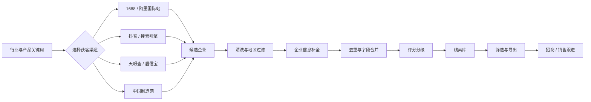
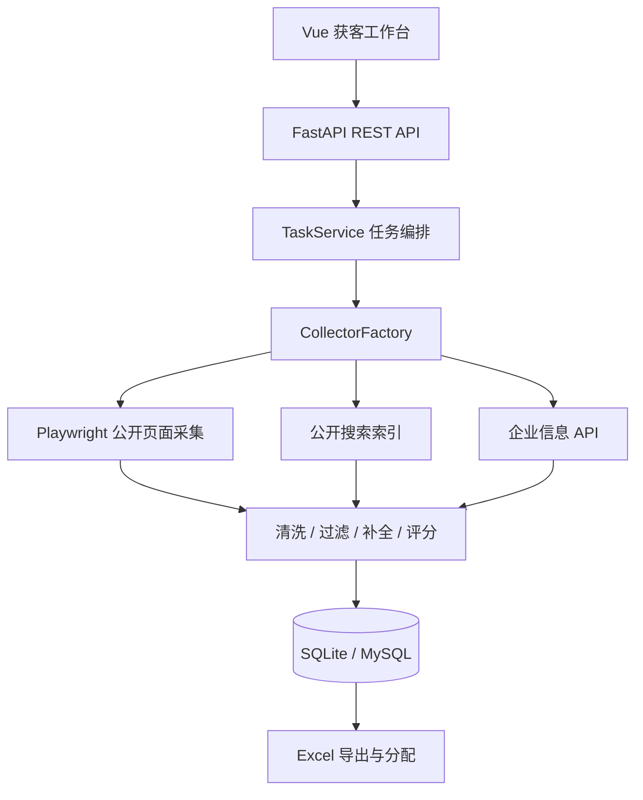

# Lead Mining Automation

[](LICENSE)

面向招商、渠道拓展与 B2B 销售团队的本地化精准获客系统。

项目将分散在 1688、阿里国际站、抖音、天眼查、启信宝和中国制造网等公开渠道中的企业线索，转化为可以筛选、补全、评分、分配和导出的客户资产，帮助业务团队完成从“找企业”到“可跟进名单”的获客闭环。

> 项目定位：公开商业信息发现与企业线索整理工具，不提供登录绕过、验证码破解或平台安全机制规避能力。

## 为什么做这个项目

传统招商获客经常面临这些问题：

- 企业名单分散在多个平台，人工搜索效率低。
- 公司名称、联系方式、主营产品和地区信息不完整。
- 重复企业反复进入名单，浪费销售跟进时间。
- 线索缺少优先级，业务人员不知道先联系谁。
- Excel 在不同人员之间流转后，难以判断哪些线索已经分配。

本项目把获客流程整理为一条可执行的数据链路：

```text
确定行业与产品关键词
        ↓
多渠道发现潜在企业
        ↓
清洗、地区过滤与去重
        ↓
企业信息核验与字段补全
        ↓
线索评分和 A/B/C/D 分级
        ↓
筛选、分配并导出 Excel
        ↓
进入销售或招商跟进流程
```

## 核心能力

### 1. 多渠道潜客发现

- **1688 企业采集**：从企业搜索结果页发现工厂、厂家和供应商，支持广东省及地级市筛选。
- **阿里国际站采集**：按英文产品关键词发现供应商，保留英文公司名、主营产品、店铺等级和供应商主页。
- **中国制造网 + 天眼查**：先发现制造商，再通过企业公开信息补充法人、电话、地址等字段。
- **抖音企业线索**：从公开账号和企业主页中提取商业线索。
- **天眼查 / 启信宝公开页**：按关键词发现并整理公开企业信息。
- **AI 1688 搜企**：从搜索引擎已收录的 1688 公开摘要中发现候选企业，再进入补全流程。

### 2. 线索清洗与质量控制

- 公司名称、联系人、电话、统一社会信用代码和注册地址清洗。
- 省、市、区县自动解析与目标地区过滤。
- 注销、吊销、异常主体和明显无效企业过滤。
- 按公司名称、来源主页和店铺链接执行去重。
- 重复线索不会简单丢弃，而会合并更完整的公开字段。

### 3. 企业信息补全

- 1688 采集完成后，可按指定批次使用天眼查公开页补全。
- 可通过启信宝 API 补全工商照面、联系方式和股东信息。
- 支持批量大小、请求间隔、随机抖动和批次冷却设置。
- 页面需要登录或人工验证时，任务可以进入人工接管状态。

### 4. 获客评分与分层

系统根据以下信号计算 `0-100` 分：

- 产品或行业相关度。
- 企业经营状态。
- 企业认证或平台可信信号。
- 是否存在公开联系电话。
- 是否存在官网或店铺主页。
- 商业意图关键词和经营异常风险。

最终将线索划分为：

| 等级 | 分数 | 建议用途 |
| --- | ---: | --- |
| A | 80-100 | 优先联系与重点转化 |
| B | 60-79 | 进入常规销售跟进 |
| C | 40-59 | 二次核验或培育 |
| D | 0-39 | 低优先级或暂不跟进 |

### 5. 线索管理与分发

- 按采集路线、行业、城市、关键词、等级和分配状态筛选。
- 导出全部筛选结果，或只导出 A/B 高价值线索。
- 可选择是否对电话字段脱敏。
- Excel 成功导出后，相关线索自动标记为“已分配”。
- 支持查看任务进度、执行日志和企业核验额度。

### 6. Excel 企业反证

系统提供三个独立的 Excel 批量核验工具：

- **1688 企业反证**：判断企业在 1688 公开索引中是否存在。
- **天眼查企业反证**：补充匹配企业、法人、联系人、电话和地址。
- **启信宝企业反证**：通过 API 查询并输出结构化企业信息。

## 获客流程示意



## 技术架构

| 层级 | 技术 |
| --- | --- |
| 前端 | Vue 3、TypeScript、Pinia、Vite |
| 后端 | Python、FastAPI、Pydantic |
| 页面采集 | Playwright、Microsoft Edge / Chromium |
| 数据库 | SQLite（默认）或 MySQL 8.0 |
| Excel | openpyxl |
| 可选 AI | DeepSeek API |



## 项目结构

```text
lead-mining-automation/
├─ backend/
│  ├─ app/
│  │  ├─ api/           # FastAPI 路由
│  │  ├─ core/          # 配置、常量和数据库初始化
│  │  ├─ model/         # Pydantic 请求与业务模型
│  │  ├─ repository/    # 任务、线索和额度持久化
│  │  ├─ service/       # 采集器、任务编排、补全、评分和导出
│  │  └─ util/          # 电话、地址、联系人、产品名等清洗工具
│  ├─ tests/            # 后端单元与回归测试
│  └─ tools/            # 页面导入书签和数据修复工具
├─ frontend/
│  └─ src/
│     ├─ api/           # 前端 API 客户端
│     ├─ components/    # 任务、线索、反证、额度和日志界面
│     └─ stores/        # Pinia 状态管理
├─ database/            # MySQL 初始化 SQL
├─ deployment/windows/  # Windows 安装、启动、停止和打包脚本
├─ docs/                # 功能设计与实施记录
└─ README.md
```

## 快速开始

### 方式一：Windows 一键配置

适合首次体验项目。

```powershell
git clone https://github.com/Krive18/lead-mining-automation.git
cd lead-mining-automation
```

然后依次双击：

```text
setup_environment.bat
start_project.bat
```

启动后访问：

- 前端工作台：`http://127.0.0.1:5173/`
- 后端健康检查：`http://127.0.0.1:8000/api/health`
- FastAPI 接口文档：`http://127.0.0.1:8000/docs`

### 方式二：手动启动

后端：

```powershell
cd backend
python -m venv .venv
.\.venv\Scripts\python.exe -m pip install -r requirements.txt
Copy-Item .env.example .env
.\.venv\Scripts\python.exe -m uvicorn app.main:app --reload --host 127.0.0.1 --port 8000
```

前端：

```powershell
cd frontend
npm install
npm run dev -- --host 127.0.0.1 --port 5173
```

## 配置说明

默认使用 SQLite，首次运行时自动创建数据库。

本地配置文件：

```text
backend/.env
```

该文件包含数据库密码和第三方服务密钥，已经被 `.gitignore` 排除，请勿提交。

### 切换到 MySQL

```dotenv
LEAD_DATABASE_DRIVER=mysql
MYSQL_HOST=127.0.0.1
MYSQL_PORT=3306
MYSQL_USER=root
MYSQL_PASSWORD=你的数据库密码
MYSQL_DATABASE=lead_mining
MYSQL_CHARSET=utf8mb4
```

后端启动时会自动创建数据库并执行结构迁移，也可以手动运行 `database/init.sql`。

### 可选服务

```dotenv
# 启信宝企业信息补全
QIXIN_APP_KEY=
QIXIN_SECRET_KEY=

# DeepSeek 关键词辅助和页面识别
AI_PAGE_RECOGNITION_ENABLED=false
DEEPSEEK_API_KEY=

# 公开搜索服务
WEB_SEARCH_PROVIDER=duckduckgo_html
WEB_SEARCH_API_KEY=
WEB_SEARCH_ENDPOINT=
```

未配置可选密钥时，对应能力会关闭或退化为本地规则，不影响基础页面采集与线索管理。

## 关键代码入口

| 文件 | 作用 |
| --- | --- |
| `backend/app/main.py` | 后端启动、日志、数据库初始化和路由注册 |
| `backend/app/api/routes.py` | 任务、线索、反证、导出和额度 API |
| `backend/app/service/task_service.py` | 获客任务全流程编排 |
| `backend/app/service/collector_service.py` | 多渠道公开页面采集器 |
| `backend/app/service/alibaba_international_collector.py` | 阿里国际站供应商采集 |
| `backend/app/repository/lead_repository.py` | 数据库读写、筛选、去重和合并 |
| `backend/app/service/scoring_service.py` | 线索评分和 A/B/C/D 分层 |
| `backend/app/service/export_service.py` | Excel 导出与分配状态更新 |
| `frontend/src/components/TaskComposer.vue` | 获客任务创建与补全入口 |
| `frontend/src/stores/leadStore.ts` | 前端任务、线索、额度和日志状态 |

## 开发与验证

运行后端测试：

```powershell
cd backend
.\.venv\Scripts\python.exe -m pytest -q
```

检查并构建前端：

```powershell
cd frontend
npm run build
```

## 当前边界

- 这是一个面向本地使用的单机工作台，当前没有多用户登录和团队权限体系。
- 采集任务由 FastAPI 进程内后台任务执行，不依赖 Redis 或独立任务队列。
- 浏览器采集依赖第三方页面结构，平台页面调整后可能需要更新解析规则。
- 登录、验证码或访问限制需要用户在浏览器中自行完成，系统不会绕过平台安全机制。
- 企查查真实 API 适配器尚未接入；启信宝 API 为当前可选的接口补全渠道。
- 反证任务的实时状态保存在后端进程内存中，重启后已生成文件仍在，但任务进度历史不会保留。

## 数据与安全

项目会处理企业名称、联系人、电话和地址等商业信息。公开部署或二次开发时请注意：

- 仅处理你有权访问和使用的公开信息。
- 遵守目标平台服务条款、robots 规则、适用隐私和数据保护法规。
- 不要规避登录、验证码、访问频率限制或其他安全控制。
- 不要将 `backend/.env`、`backend/data`、`backend/exports`、浏览器用户目录或运行日志提交到版本库。
- 对外共享线索前，建议启用电话脱敏并建立访问、留存和删除制度。

## 面向获客的后续方向

- ICP 理想客户画像与行业模板。
- 关键词策略库和定时获客任务。
- 多渠道线索统一置信度与转化评分。
- 线索池、负责人分配和跟进状态管理。
- CRM、企业微信、飞书或 Webhook 推送。
- 联系、有效商机、成交等转化漏斗回传。
- 黑名单、退订和数据保留周期管理。

## 参与贡献

欢迎提交错误修复、采集稳定性改进、清洗规则、测试和文档。贡献前请阅读：

- [参与贡献指南](CONTRIBUTING.md)
- [社区行为准则](CODE_OF_CONDUCT.md)
- [安全政策](SECURITY.md)
- [使用与合规免责声明](DISCLAIMER.md)

请勿在 Issue、Pull Request、示例或测试中提交真实客户数据、联系方式、密钥、Cookie、浏览器登录态，或任何用于绕过平台安全机制的实现。

## License

Copyright (c) 2026 Krive18

本项目基于 [GNU Affero General Public License v3.0](LICENSE)（`AGPL-3.0-only`）开源。

你可以使用、修改和分发本项目，也可以将其用于商业用途，但必须遵守许可证中的源码提供、版权声明保留、修改说明和相同许可证等要求。若修改本项目并通过网络向用户提供服务，还需要按照 AGPL-3.0 的要求向相关用户提供对应源码。

许可证只覆盖本项目代码，不代表你获得第三方平台数据、商标、账号或接口的使用授权。使用前请同时阅读 [使用与合规免责声明](DISCLAIMER.md)。
